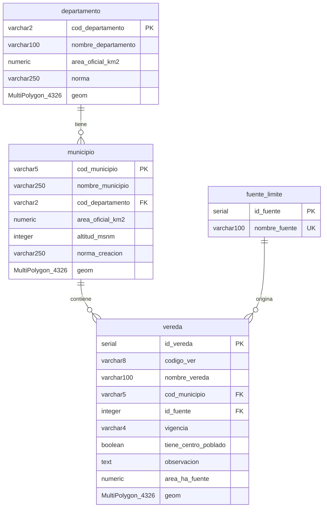
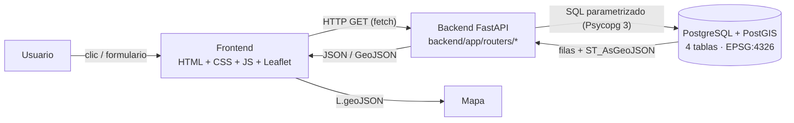
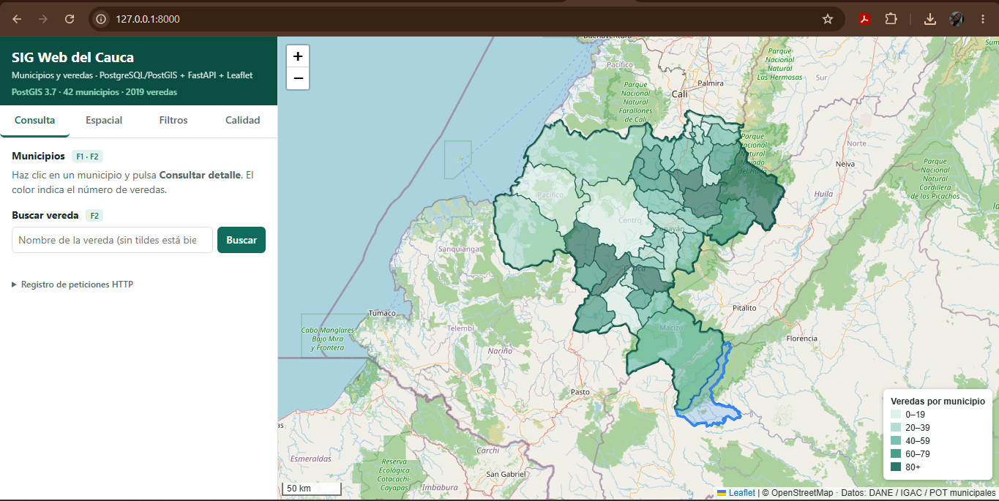
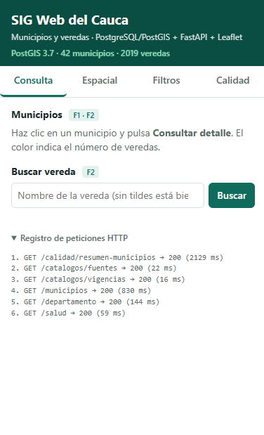
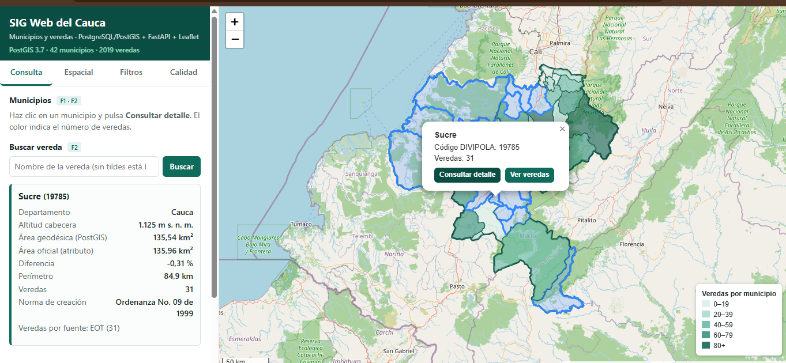
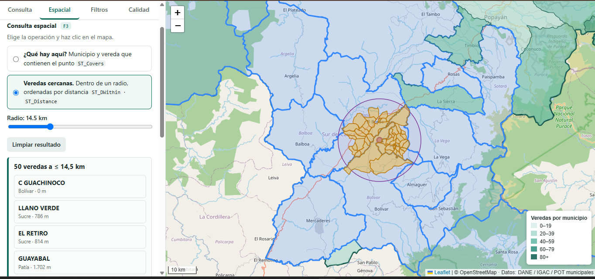
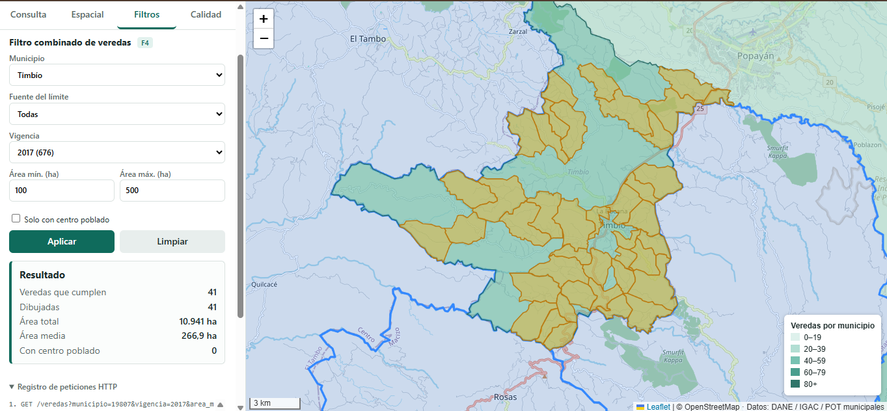
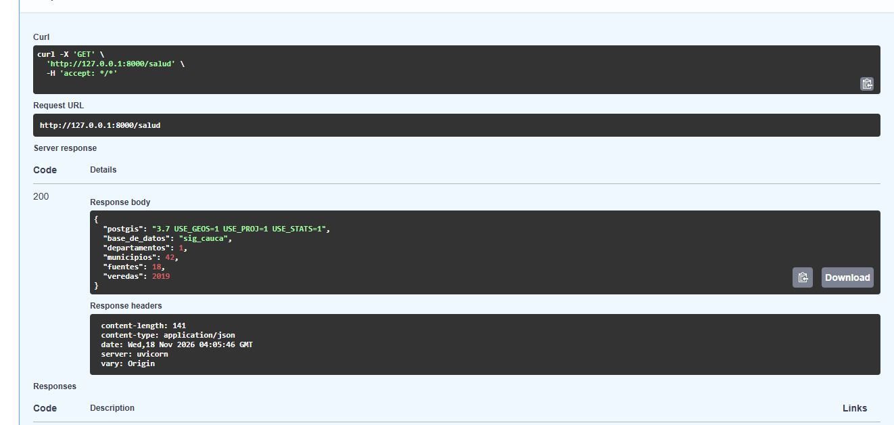
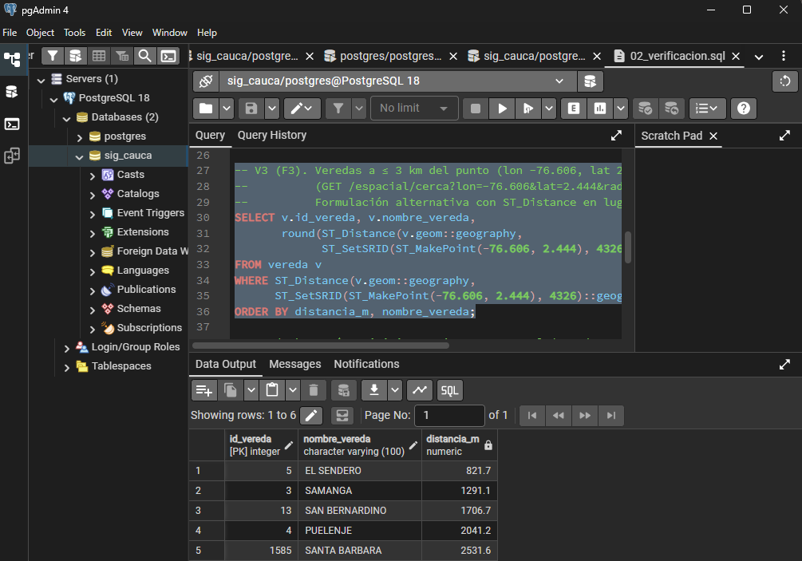

# SIG Web del Cauca — municipios y veredas sobre PostgreSQL/PostGIS

Tarea integradora · Programación para SIG · Ingeniería Topográfica y Geomática · Universidad del Quindío
**Autora:** Maira Lucia Zuñiga Gomez

Visor SIG Web que consulta una geodatabase **PostgreSQL/PostGIS** del departamento del Cauca (Colombia)
mediante una API **FastAPI** y representa los resultados con **Leaflet**.

---

## 1. Objetivo y alcance

**Pregunta geográfica:** ¿cómo se distribuyen las veredas del Cauca por municipio, de qué fuente proviene el
límite de cada una y qué tan confiable es su ubicación respecto al límite municipal?

El visor permite:

- visualizar los 42 municipios (coropleta por número de veredas) y el contorno departamental (**F1**);
- consultar atributos de un municipio (área geodésica, perímetro, veredas por fuente) o buscar una vereda por nombre (**F2**);
- hacer clic en el mapa para saber qué municipio/vereda contiene un punto y qué veredas hay a cierta distancia en metros (**F3**);
- filtrar veredas por municipio, fuente, vigencia, rango de área y centro poblado, y detectar veredas que quedan fuera del municipio que declaran (**F4**).

**Fuera de alcance:** edición de datos, autenticación, despliegue en servidor público.

## 2. Fuentes de información

| Capa | Archivo | Geometría | CRS original | Registros | Descripción |
|------|---------|-----------|--------------|-----------|-------------|
| Departamento | `data/raw/CAUCA.shp` | Polygon | EPSG:9377 (MAGNA-SIRGAS 2018 / Origen-Nacional) | 1 | Límite departamental (`DeCodigo`, `DeNombre`, `DeArea`, `DeNorma`) |
| Municipios | `data/raw/MUNICIPIOS.shp` | Polygon | EPSG:9377 | 42 | Límite municipal (`MpCodigo` DIVIPOLA, `MpNombre`, `MpArea`, `MpAltitud`, `MpNorma`) |
| Veredas | `data/raw/VEREDAS.shp` | Polygon | EPSG:4326 | 2019 | Veredas compiladas de **múltiples fuentes** (capa `CRVeredas_2020`); cada registro indica su `FUENTE` y `VIGENCIA` |

**Procedencia de los archivos.** Los tres shapefiles fueron descargados por la autora desde
[Colombia en Mapas](https://www.colombiaenmapas.gov.co/), el geoportal de la Infraestructura Colombiana de Datos
Espaciales (ICDE), coordinado por el Instituto Geográfico Agustín Codazzi (IGAC), y luego recortados al
departamento del Cauca.

| Capa | Plataforma de descarga | Fecha de descarga |
|------|------------------------|-------------------|
| Departamento y municipios | Colombia en Mapas (ICDE / IGAC) | 12 de noviembre de 2026 |
| Veredas (`CRVeredas_2020`) | Colombia en Mapas (ICDE / IGAC); capa compilada de varias entidades, la fuente de cada vereda está en `fuente_limite` (DANE, Catastro IGAC, POT municipales, UNODC, CAR…) | 12 de noviembre de 2026 |

Los metadatos de la capa municipal advierten que no es apropiada para la ubicación exacta de puntos ni para el
cálculo de áreas y distancias (ver §11).

Las veredas provienen de 18 fuentes distintas (POT municipales, Catastro IGAC, DANE, UNODC, EOT, ESRI, CAR,
Unidad de Víctimas, etc.); ese catálogo es la tabla `fuente_limite`.

**Sistema de referencia.** Todo se almacena en **EPSG:4326 (WGS 84)**. Los municipios y el departamento se
reproyectan desde EPSG:9377 dentro de PostGIS con `ST_Transform` al cargarlos (`scripts/cargar_datos.py`).
Las diferencias entre MAGNA-SIRGAS 2018 y WGS 84 son del orden de decímetros o menos, despreciables a esta escala.

## 3. Modelo relacional de la geodatabase



| Tabla | Registros | PK | FK | Geometría |
|-------|-----------|----|----|-----------|
| `departamento` | 1 | `cod_departamento` | — | MultiPolygon, 4326 |
| `municipio` | 42 | `cod_municipio` | `cod_departamento → departamento` | MultiPolygon, 4326 |
| `fuente_limite` | 18 | `id_fuente` | — | (catálogo) |
| `vereda` | 2019 | `id_vereda` | `cod_municipio → municipio`, `id_fuente → fuente_limite` | MultiPolygon, 4326 |

**Decisiones de diseño**

- `fuente_limite` no es una tabla de relleno: sus 18 valores salen del atributo `FUENTE` de los datos reales y
  permiten consultar la procedencia de cada límite veredal (JOIN usado en F2 y F4).
- `vereda.codigo_ver` **no es único** en la fuente (el código `19807040` de Timbío aparece en 3 polígonos
  separados), por eso la PK es una clave sustituta `id_vereda`.
- Restricciones: `CHECK` del formato DIVIPOLA y de que el código municipal comience con el código del departamento.
- Índices GIST sobre cada `geom` y un índice GIST **funcional** sobre `vereda((geom::geography))` para que
  `ST_DWithin` en metros use índice.
- Del atributo `DESCRIPCIO` de las veredas se derivaron `tiene_centro_poblado` (valor "CON CENTRO POBLADO") y
  `observacion` (el resto de notas de edición).

Scripts: [`sql/01_esquema.sql`](sql/01_esquema.sql) (estructura) y [`scripts/cargar_datos.py`](scripts/cargar_datos.py) (carga).

## 4. Arquitectura



| Componente | Tecnología | Archivos |
|------------|-----------|----------|
| Frontend | HTML, CSS, JavaScript, Leaflet 1.9 | `frontend/index.html`, `css/style.css`, `js/config.js`, `js/api.js`, `js/mapa.js`, `js/app.js` |
| Backend/API | Python, FastAPI | `backend/app/main.py`, `routers/*.py` |
| Conexión | Psycopg 3 + pool | `backend/app/db.py`, `config.py` |
| Geodatabase | PostgreSQL 16 + PostGIS 3.4 | `sql/`, `scripts/` |

Dónde mirar cada requisito del enunciado:

| Requisito | Dónde está |
|-----------|-----------|
| Archivos del frontend (interfaz e interacciones) | `frontend/js/app.js` (eventos), `frontend/index.html` |
| Endpoints HTTP | `backend/app/routers/` (y `/docs` con la API en marcha) |
| Conexión con PostgreSQL | `backend/app/db.py` (pool) + `backend/app/config.py` (variables de entorno) |
| Consultas SQL | dentro de cada función de `backend/app/routers/*.py` |
| Construcción del GeoJSON | `feature_collection()` en `backend/app/db.py` |
| Recepción y dibujo en Leaflet | `frontend/js/api.js` (fetch) y `frontend/js/mapa.js` / `app.js` (`L.geoJSON`) |

## 5. Requisitos e instalación

Necesitas: **PostgreSQL con PostGIS 3** (probado con PostgreSQL 16 y PostGIS 3.4; la extensión `unaccent` está en el paquete contrib estándar), **Python 3.10+** y un navegador.

```bash
# 1. Crear la base de datos (con el usuario administrador de PostgreSQL)
createdb -U postgres sig_cauca
# (en pgAdmin: clic derecho en Databases → Create → Database → "sig_cauca")

# 2. Entorno Python
python -m venv .venv
source .venv/bin/activate            # Windows: .venv\Scripts\activate
pip install -r requirements.txt

# 3. Credenciales (el archivo .env NO se sube a GitHub)
cp .env.example .env                 # Windows: copy .env.example .env
#    edita .env con tu usuario y contraseña de PostgreSQL

# 4. Crear tablas y cargar los datos reales (borra y recrea las tablas)
python scripts/cargar_datos.py --crear-esquema
```

Salida esperada: `departamento: 1`, `municipio: 42`, `fuente_limite: 18`, `vereda: 2019`.
Si prefieres crear la estructura a mano: `psql -U postgres -d sig_cauca -f sql/01_esquema.sql` y luego `python scripts/cargar_datos.py`.

## 6. Ejecución

```bash
# Desde la raíz del repositorio, con el entorno virtual activo
uvicorn backend.app.main:app --reload
```

- Visor: <http://127.0.0.1:8000/> (la API también sirve el frontend)
- Documentación interactiva de la API (Swagger): <http://127.0.0.1:8000/docs>
- Alternativa con servidores separados: `cd frontend && python -m http.server 5500` y abrir <http://127.0.0.1:5500>
  (`js/config.js` detecta que no está en el puerto 8000 y apunta a `http://127.0.0.1:8000`; CORS está habilitado).

El mapa base de OpenStreetMap requiere conexión a internet; las capas vienen de la geodatabase.

## 7. Funcionalidades y endpoints

| Func. | Qué hace el usuario | Endpoint | Operación PostGIS / SQL |
|-------|--------------------|----------|-------------------------|
| **F1** | Al abrir el visor se dibuja el departamento y los 42 municipios (color = nº de veredas) | `GET /departamento`, `GET /municipios` | `ST_AsGeoJSON`, `ST_SimplifyPreserveTopology`, `LEFT JOIN` + `count` |
| **F2** | Clic en un municipio → «Consultar detalle» | `GET /municipios/{cod}` | `ST_Area(geom::geography)`, `ST_Perimeter(geom::geography)`, JOIN con `departamento` y `fuente_limite` |
| **F2** | Busca una vereda por nombre (sin tildes) → ficha | `GET /veredas/buscar?q=`, `GET /veredas/{id}` | `unaccent(...) ILIKE`, `ST_PointOnSurface` |
| **F3** | Pestaña Espacial → clic: ¿qué hay aquí? | `GET /espacial/punto?lon=&lat=` | `ST_Covers(geom, ST_SetSRID(ST_MakePoint(...),4326))` |
| **F3** | Pestaña Espacial → clic + radio: veredas cercanas | `GET /espacial/cerca?lon=&lat=&radio_m=` | `ST_DWithin` y `ST_Distance` sobre `::geography` (metros) |
| **F4** | Filtro combinado + estadísticas | `GET /veredas?municipio=&id_fuente=&vigencia=&area_min_ha=&area_max_ha=&solo_centro_poblado=` | filtros opcionales parametrizados, `ST_Area`, `avg`, `count FILTER` |
| **F4** | Calidad: veredas fuera de su municipio | `GET /calidad/inconsistencias` | `ST_PointOnSurface` + `ST_Covers` |
| **F4** | Ranking de municipios | `GET /calidad/resumen-municipios` | agregaciones por municipio |
| — | Estado de la conexión, catálogos de filtros | `GET /salud`, `/catalogos/fuentes`, `/catalogos/vigencias` | `postgis_version()`, `count` |

### Justificación de la consulta espacial (F3): geometrías, CRS y unidades

- **Geometrías:** el punto del usuario es un `Point` (clic de Leaflet) y las veredas/municipios son `MultiPolygon`.
  La relación punto-polígono se resuelve con `ST_Covers`, que incluye el borde (un punto exactamente sobre un
  límite pertenece al polígono; `ST_Contains` lo excluiría).
- **CRS:** los datos se guardan en EPSG:4326 (grados) y el clic de Leaflet llega como lon/lat WGS 84, así que no
  hay discrepancia de SRID entre el punto y las geometrías (`ST_SetSRID(..., 4326)`).
- **Unidades:** en EPSG:4326, `ST_Area` devuelve grados² y `ST_Distance` grados, magnitudes sin sentido métrico
  (consulta V7 de `sql/02_verificacion.sql`). Por eso las operaciones métricas se hacen sobre `geom::geography`,
  que calcula sobre el elipsoide WGS 84 y devuelve **metros** y **m²**. El radio de `ST_DWithin` va en metros.
- **Rendimiento:** el índice GIST funcional `idx_vereda_geog` sobre `(geom::geography)` permite que `ST_DWithin`
  use índice en lugar de recorrer las 2019 veredas.

## 8. Demostración: recorrido completo de una operación (F3 «Veredas cercanas»)

**1. Interacción del usuario.** En la pestaña *Espacial* elige «Veredas cercanas», fija el radio y hace clic en
el mapa. Para reproducir el ejemplo exacto: <http://127.0.0.1:8000/docs> → `GET /espacial/cerca` con
`lon=-76.606`, `lat=2.444`, `radio_m=3000`.

**2. Endpoint.** `consultaEspacial()` en `frontend/js/app.js` llama a `api("/espacial/cerca", {lon, lat, radio_m})`
(`frontend/js/api.js`, `fetch`), que genera:

```
GET /espacial/cerca?lon=-76.606&lat=2.444&radio_m=3000
```

**3. Consulta SQL/PostGIS** (`backend/app/routers/espacial.py`, parámetros `%(lon)s`, `%(lat)s`, `%(radio)s` enviados
por Psycopg separados del texto SQL):

```sql
WITH p AS (SELECT ST_SetSRID(ST_MakePoint(%(lon)s, %(lat)s), 4326)::geography AS g)
SELECT v.id_vereda, v.nombre_vereda, m.nombre_municipio,
       round(ST_Distance(v.geom::geography, p.g)::numeric, 1) AS distancia_m,
       ST_AsGeoJSON(ST_SimplifyPreserveTopology(v.geom, 0.0002), 6) AS geometria
FROM vereda v JOIN municipio m ON m.cod_municipio = v.cod_municipio, p
WHERE ST_DWithin(v.geom::geography, p.g, %(radio)s)
ORDER BY distancia_m, v.nombre_vereda LIMIT %(limite)s;
```

**4. Respuesta GeoJSON** (`feature_collection()` en `backend/app/db.py` convierte cada fila en un `Feature`;
geometrías abreviadas aquí):

```json
{ "type": "FeatureCollection",
  "features": [
    { "type": "Feature", "id": 5,
      "geometry": { "type": "Polygon", "coordinates": [ "..." ] },
      "properties": { "id_vereda": 5, "nombre_vereda": "EL SENDERO",
                      "nombre_municipio": "Popayán", "distancia_m": 821.7 } },
    "... 5 features más: SAMANGA 1291.1 m, SAN BERNARDINO 1706.7 m, PUELENJE 2041.2 m, SANTA BARBARA 2531.6 m, ANTON MORENO 2779.6 m" ],
  "centro": { "lon": -76.606, "lat": 2.444 }, "radio_m": 3000.0, "total": 6 }
```

**5. Representación en Leaflet.** `consultaEspacial()` recibe el JSON y ejecuta `L.geoJSON(r, {style})` para dibujar
las veredas, `L.circle(latlng, {radius: radioM})` para el radio y lista los resultados con su distancia en el panel.

**Contraste con SQL directo.** El mismo resultado se obtiene en `psql`/pgAdmin con una formulación distinta
(`ST_Distance(...) <= 3000`, consulta V3 en [`sql/02_verificacion.sql`](sql/02_verificacion.sql)): 6 veredas con ids
`3, 4, 5, 13, 1585, 1933`.

## 9. Seguridad

- **Consultas parametrizadas:** todos los valores del usuario viajan como parámetros de Psycopg (`%(nombre)s`); en
  ningún endpoint se concatenan entradas externas en el SQL. Los filtros opcionales de `/veredas` se escriben como
  `(%(x)s::tipo IS NULL OR condición)`, de modo que la estructura del SQL no depende del usuario.
- **Validación de entrada** con FastAPI (patrones, rangos, longitudes): p. ej. código DIVIPOLA `^\d{5}$`, radio ≤ 100 km.
- **Credenciales fuera del código:** se leen de `.env` (ignorado por `.gitignore`); el repositorio solo incluye `.env.example`.
- **XSS:** el frontend escapa (`esc()`) todo texto que viene de la base antes de insertarlo en HTML.

## 10. Verificación técnica y evidencias

Con la API corriendo:

```bash
python scripts/generar_evidencias.py
```

Genera `docs/evidencias/verificacion.md` (tabla que contrasta cada respuesta de la API con una consulta SQL
independiente ejecutada directamente en PostgreSQL) y `docs/evidencias/api/*.json` (respuestas de cada endpoint).
Además, `sql/02_verificacion.sql` contiene las consultas para ejecutar a mano en pgAdmin/psql.

| Evidencia | Archivo |
|-----------|---------|
| Comparación API ↔ SQL directo (10 pruebas) | [`docs/evidencias/verificacion.md`](docs/evidencias/verificacion.md) |
| Respuestas JSON/GeoJSON de la API | [`docs/evidencias/api/`](docs/evidencias/api/) |
| Capturas del visor, de `/docs`, del registro HTTP y de pgAdmin | [`docs/evidencias/capturas/`](docs/evidencias/capturas/) |

El panel **«Registro de peticiones HTTP»** del visor lista cada petición real que hace el navegador a la API
(método, ruta, código de estado y milisegundos), como evidencia de la comunicación HTTP.

### Capturas de evidencia

#### 1. Visor principal (42 municipios y 2019 veredas)


#### 2. Registro de peticiones HTTP


#### 3. Detalle de municipio


#### 4. Consulta espacial de cercanía


#### 5. Filtros combinados


#### 6. Documentación interactiva Swagger (/docs)


#### 7. Verificación directa en PostgreSQL / PostGIS (pgAdmin 4)



## 11. Limitaciones y observaciones sobre los datos

- Los metadatos de la capa municipal advierten que no es apropiada para ubicación exacta de puntos ni para cálculo
  de áreas y distancias. Por eso F2 muestra el **área geodésica** calculada en PostGIS junto al **área oficial**
  (atributo de la fuente): difieren ≈ 0,2–0,3 % porque el área oficial proviene de una proyección plana.
- 17 veredas tienen su punto interior fuera del municipio que declaran (F4 · Calidad): refleja desajustes entre las
  fuentes veredales y el límite municipal; no se corrigieron, se reportan.
- 3 veredas comparten `codigo_ver` (Timbío, 19807040): se conservan como registros separados.
- Para que el mapa sea ágil, las geometrías se simplifican al enviarlas al navegador
  (`ST_SimplifyPreserveTopology`, tolerancia ≈ 10–55 m según la capa); las áreas y distancias se calculan con la geometría completa.
- Datos de las veredas con vigencias entre 1998 y 2017 (y 185 con vigencia indefinida «INDF»).

## 12. Relación con el proyecto de referencia

Se estudió el módulo *05-sig-postgis-fastapi* del curso y se adoptó su patrón general (frontend Leaflet →
FastAPI → Psycopg → PostGIS, respuestas GeoJSON, consultas parametrizadas). Este proyecto es una solución
propia: otro territorio y otro modelo de datos (departamento → municipio → vereda ← fuente_limite, con datos
reales de límites veredales), consultas espaciales distintas (`ST_DWithin`/`ST_Distance` sobre `geography`,
`ST_Covers` punto-polígono, `ST_PointOnSurface` para control de calidad), pool de conexiones, filtros
combinados, validación de entradas, y un script que contrasta automáticamente la API con SQL directo.

## 13. Estructura del repositorio

```
├── backend/app/            API FastAPI (main, config, db, routers/)
├── frontend/               index.html, css/, js/
├── sql/                    01_esquema.sql · 02_verificacion.sql
├── scripts/                cargar_datos.py · generar_evidencias.py
├── data/raw/               shapefiles de origen
├── docs/evidencias/        verificacion.md · api/ · capturas/
├── .env.example            plantilla de credenciales (el .env real NO se sube)
├── requirements.txt
└── README.md
```
